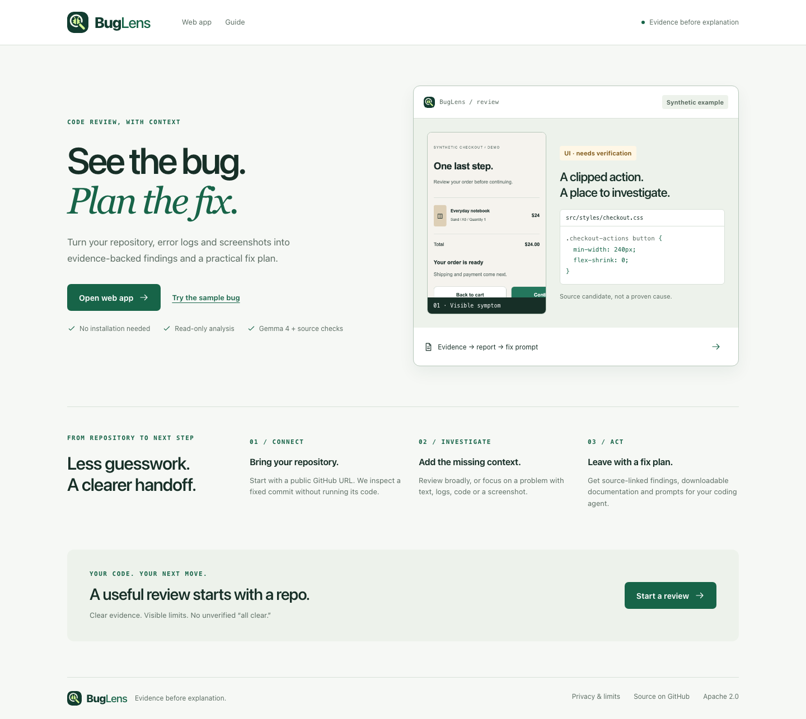

# BugLens

**Turn a bug report into a source-linked fix plan.**

BugLens helps developers investigate a public GitHub repository using source code, problem descriptions, logs and optional screenshots. It produces evidence-linked findings, a full review report, remediation documentation and prompts for an authorized coding agent to investigate the fix.

[**Try BugLens**](https://buglens-rust.vercel.app/demo) · [90-second demo](docs/DEMO_GUIDE.md) · [Test evidence](docs/TEST_REPORT.md) · [Download the complete documentation](submission/Complete_Documentation_Package.zip)

## The problem

A screenshot shows a symptom. A stack trace shows a failure. A repository contains possible causes. Connecting them—and explaining what should be verified before changing code—is still work.

BugLens brings that context into one repository-first workflow:

1. **Review the code.** Inspect a commit-pinned repository with deterministic source checks, Gemma 4 review and npm dependency advisories. Gemma 4 source review is enabled by default in the web app; the review controls let you choose which external checks run.
2. **Investigate the reported problem.** Supply text, logs, code attachments or a screenshot with expected and actual behavior.
3. **Leave with an actionable handoff.** Review source references and coverage, then download documentation and verification-first fix prompts.

**The boundary matters:** BugLens generates investigation leads, not guaranteed fixes. It does not execute or modify the repository.

## Try it in 90 seconds

1. Open the [workspace](https://buglens-rust.vercel.app/demo) and choose **Use BugLens’s own repository**, or enter a public GitHub repository.
2. Select **Repository-wide review**. For a no-model-key demonstration, turn off **Gemma 4 source review** and **Known dependency vulnerabilities**, and leave screenshots off.
3. Run the review. Inspect a finding, its source evidence and **What was actually checked**.
4. Open **Full report**, **Documentation** and **Fix prompt**. Download an artifact before refreshing.

Static review still requires GitHub connectivity. For a clearly labeled offline synthetic walkthrough, choose **Try the sample bug** with fixture mode enabled. The [demo guide](docs/DEMO_GUIDE.md) includes a failure case, reset steps and honest fallback options.



*The repository-first interface included in this source release, with the refreshed BugLens identity.*

## What you receive

| Artifact | Contents |
| --- | --- |
| `buglens-report.md` | Supplied problem, source-linked findings, inspection scope and limitations |
| `buglens-remediation.md` | Source inventory, problem register, verification targets and acceptance checklist |
| `buglens-fix-prompt.txt` | A combined investigation prompt for a coding agent; individual findings also have their own prompts |

A fix prompt is **not a terminal command or an automatic patch**. It asks the agent to inspect repository instructions, verify the issue, preserve unrelated work, make a focused change and report real test results.

## Evidence before explanation

Four implementation choices make the output inspectable:

- **Grounded source references.** Model findings must cite a supplied file, line and exact quote. Invalid references are rejected. [Validation code](src/lib/review/model.ts).
- **Separated evidence.** Screenshot observations, reporter statements and suspected causes remain distinct. A source match is not automatically the cause of a reported symptom. [Evidence schema](src/lib/schema/evidence.ts).
- **Gemma 4 only.** The adapter permits `gemma4:31b` and rejects a different returned model identifier when supplied. Requested AI failures are explicit; no alternate model or hidden fixture replaces the result. [Model adapter](src/model/gemma-client.ts).
- **One pipeline, two entry points.** The website and reusable agent skill share the review implementation, artifact compiler and boundaries. [Pipeline](src/lib/review/run.ts) · [Skill](skills/buglens/SKILL.md).

The Node API loads a bounded GitHub archive pinned to a commit, runs static checks, performs requested external checks, validates evidence and compiles the artifacts. There is no database, login, durable job queue or automatic repair service.

[Architecture](docs/architecture.md) · [Processing flowcharts](docs/FLOWCHARTS.md) · [API contract](docs/API_REFERENCE.md)

## Implemented features and verification

| Feature | Status | Source | Evidence |
| --- | --- | --- | --- |
| Public repository import and static review | Implemented | [Importer](src/lib/review/github.ts), [checks](src/lib/review/checks.ts) | Unit/contracts and recorded historical live integration |
| Problem text, supported files and artifact downloads | Implemented | [Inputs](src/lib/review/inputs.ts), [compiler](src/lib/review/report.ts) | Desktop/mobile controlled-response browser journeys |
| Gemma source and screenshot review | Implemented | [Source review](src/lib/review/model.ts), [adapter](src/model/gemma-client.ts) | Live Ollama source review and screenshot analysis passed; [migration evidence](docs/OLLAMA_MIGRATION.md) |
| Dependency security review | Partial | [OSV client](src/lib/review/checks.ts) | Exact npm versions only; tests and historical integration |
| Offline screenshot example | Mocked | [Fixtures](fixtures), [sample test](tests/e2e/sample-journey.spec.ts) | Explicit synthetic pipeline, not live model inference |
| Exhaustive runtime/security audit | Proposed | [Scope](docs/architecture.md) | Not implemented; imported code is never executed |

“Implemented” means the feature exists in source; it does not imply every live integration was successfully verified.

### Recorded checks

**101 unit/contract tests passed · 4 synthetic evaluation cases passed · Production build passed · 7 browser tests passed** after the Ollama migration.

The recorded local release run on 26 October 2026 tested the UI redesign, refreshed logo and web-app/optional-download wording. Browser checks covered desktop/mobile journeys, actual ZIP downloads and a 375/768/1024/1440px layout matrix; one duplicate matrix invocation was intentionally skipped. Controlled repository responses exercise the real static pipeline on test data, not live provider availability.

**Live integration verified:** the Ollama-backed Gemma 4 adapter completed source review of a real public repository and screenshot analysis of a synthetic image on 26 October. Source references and all three artifacts passed validation. See [exact scope and results](docs/OLLAMA_MIGRATION.md). These checks are not a model-accuracy benchmark, complete security audit or scalability measurement.

[Commands, outcomes, screenshots and limitations](docs/TEST_REPORT.md)

## Run locally

Requires Node **20.18+** and npm. From the repository root:

```sh
npm ci
cp .env.example .env.local
npm run dev
```

Open `http://127.0.0.1:3000`. For static-only use, disable source AI, dependency checks and screenshots as described above. The explicit synthetic sample uses `DEMO_MODE=fixture`.

| Environment variable | Purpose |
| --- | --- |
| `OLLAMA_API_KEY` | Server-only Ollama credential for live AI; never expose through `NEXT_PUBLIC_` |
| `GEMMA_MODEL` | Only accepted model: `gemma4:31b` |
| `DEMO_MODE` | `fixture` enables the separate synthetic screenshot demo |
| `MAX_UPLOAD_MB` | Screenshot ceiling: example 8 locally; capped at 4 when running on Vercel |

Ollama Cloud is the API transport; **Gemma 4 is the model**. Real repository review never uses fixture mode.

```sh
npm run typecheck
npm test
npm run evals
npm run build
npm run test:e2e
npm run check:secrets
```

Stop an existing development server before production browser tests. Setup commands match the manifest; build/start and tests were exercised in the installed checkout, but a fresh `npm ci` was not repeated in the documentation pass.

### Use the reusable skill

From this source checkout:

```sh
npm run skill:review -- --github https://github.com/yatharthvishnoi08-max/buglens --artifact report
```

**The web app requires no installation.** The optional [agent skill ZIP](https://buglens-rust.vercel.app/buglens-skill.zip) contains instructions and scripts for a coding agent, not a desktop app or installer. The [skill guide](skills/buglens/SKILL.md) covers developer setup, problem inputs, screenshots and explicit authorization for external checks. The separate source ZIP contains the application code.

## Supported scope, privacy and limits

- **Repositories:** public GitHub repositories, default branch only. No private-repository login or branch selection.
- **Problem inputs:** direct text and up to three supported UTF-8 text/code attachments. Each input is limited to 20,000 characters; combined problem text is limited to 60,000 bytes.
- **Screenshots:** PNG, JPEG or WebP, up to 4 MiB on Vercel or 8 MiB locally. PDFs, Word, archives, audio and video are not parsed; provide relevant text or screenshots.
- **Source inspection:** at most 1,000 supported files and 8 MiB total. AI sees at most 16 excerpts / 45,000 source characters. OSV checks up to 200 distinct exact npm versions.
- **Not performed:** repository installation/execution, runtime tests, browser testing of the target app, penetration testing or performance measurement. Zero findings is not an all-clear.
- **Data handling:** results stay in browser memory. Download before refresh. GitHub receives repository requests; Ollama receives selected source/problem or screenshot context when AI is enabled; OSV receives package names/versions when requested.
- **Secrets:** redaction and sensitive-path filtering are incomplete. Do not submit credentials or sensitive personal data. Provider and hosting handling are separate from BugLens.

[Full security/privacy assessment](docs/SECURITY_AND_PRIVACY.md) · [Exact resource limits and proposed scalability work](docs/SCALABILITY_REPORT.md)

## Documentation and submission package

[**All reports and diagrams in one ZIP**](submission/Complete_Documentation_Package.zip) · [Four-page project report](submission/Project_Submission_Report.pdf) · [Document index](docs/INDEX.md)

The PDF and rendered diagrams retain the earlier Google-backed release snapshot. The [Ollama migration note](docs/OLLAMA_MIGRATION.md) documents the active provider and new live verification evidence.

| Document | Covers |
| --- | --- |
| [Architecture and flowcharts](docs/architecture.md) | Current components, processing and trust boundaries |
| [Test report](docs/TEST_REPORT.md) | Observed checks, fixtures, failures and evidence gaps |
| [Scalability report](docs/SCALABILITY_REPORT.md) | Bottlenecks, current bounds and an explicitly unexecuted load-test plan |
| [API reference](docs/API_REFERENCE.md) | Request fields, streaming responses and errors |
| [Operations runbook](docs/OPERATIONS_RUNBOOK.md) | Release checks, incident triage and recovery planning |
| [Demo and upload checklist](submission/START_HERE.md) | Walkthrough, package navigation and remaining submission actions |

### Release and team status

The deployment uses Vercel. This source release includes the repository-first UI, refreshed logo, responsive states and clearer web-app/optional-download guidance. GitHub publication and Vercel deployment are separate steps; verify the deployed version before recording a demo. See the [UI handoff](docs/UI_HANDOFF.md).

Official challenge requirements and confirmed team names/contributions were not supplied. The submission owner must add them and verify eligibility before filing the entry. Team contributions are not inferred from repository ownership. Capacity, impact and competitive ranking are not claimed without evidence.

## License

[Apache 2.0](LICENSE).
