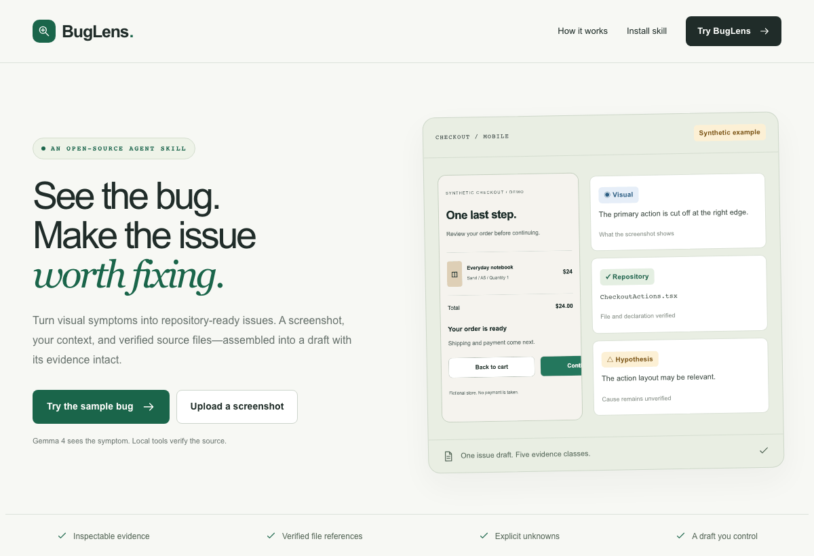
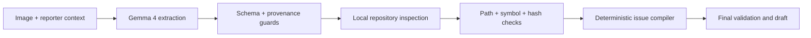

# BugLens

BugLens is an open-source multimodal skill that turns visual bug symptoms into repository-ready issues. Give an agent a screenshot, reporter context and a repository. Gemma 4 extracts only visible evidence; local tools verify relevant files and symbols; a deterministic compiler separates observations, reporter statements, repository facts, hypotheses and unknowns. BugLens drafts issues—it does not claim a root cause or silently modify code.

**Turn visual symptoms into repository-ready issues.**

## 1. Product distinction

The primary artifact is [the installable agent skill](skills/buglens/SKILL.md). The website demonstrates the same implementation. The only three product capabilities are visual evidence extraction, deterministic repository grounding, and validated issue compilation.

Gemma observations remain fallible. Validation enforces structure and provenance and rejects common unsupported inferences; it does not prove visual truth. No quality-improvement or root-cause accuracy claim has been measured.

## 2. Live demo and short GIF

Run `npm run dev` and open [localhost:3000](http://localhost:3000). A public hosted URL has not been created. Production serving and deployment preparation are documented below.



This GIF shows the implemented fixture journey, not a live model request. [Desktop and mobile captures](docs/screenshots/) and [verification notes](docs/verification.md) document the checks. The website's **Live Gemma 4** option transmits the chosen screenshot and context to Google; **Synthetic fixture mode** uses recorded evidence and is prominently labeled.

## 3. Why this is an agent skill

The [SKILL.md](skills/buglens/SKILL.md) describes invocation boundaries, inputs, exact scripts, evidence rules, failures and an end-to-end example. Its portable scripts and fixtures can run without Next.js. The agent invokes the script, reviews a validated result, and returns an issue draft.

Download `public/buglens-skill.zip` after `npm run skill:package`, extract the `buglens` folder into the agent's skill directory, and install dependencies inside that folder:

```sh
cd /path/to/installed/buglens
npm install --ignore-scripts
node scripts/compile-issue.mjs --sample --markdown
```

Ask an agent: “Use $buglens to draft an issue from this screenshot, reporter context, and authorized local repository.” The portable `.mjs` files are generated from the same TypeScript core as the website; there is no separate mock implementation.

## 4. Sixty-second reproducible example

With Node 20.18+ installed, from this repository:

```sh
npm ci
npm run skill:sample -- --markdown
npm run dev
```

The CLI example needs no API key. In the website choose **Try the sample bug**, then **Generate issue draft**. Inspect provenance and download the Markdown. The sample uses the real scanner and compiler with explicitly recorded model evidence.

For a live run, set `GEMINI_API_KEY` in your environment and supply actual input paths:

```sh
node --import tsx skills/buglens/scripts/compile-issue.ts \
  --image /absolute/screenshot.png \
  --context /absolute/reporter.json \
  --repo /absolute/repository --markdown
```

Use [examples/reporter.json](skills/buglens/examples/reporter.json) for the context shape. The local CLI reads an authorized local repository. The hosted demo always inspects the bundled synthetic repository, including for custom image uploads.

## 5. Architecture



See [architecture and trust boundaries](docs/architecture.md). The image is placed before reporter text in the multimodal request. Repository contents are never sent to Gemma. Next.js streams actual stage transitions as NDJSON; React retains the result only in tab memory.

## 6. Evidence model

| Class | What it means | Example |
| --- | --- | --- |
| Visual | Model observation of visible appearance | The right action is cut off at the image edge. |
| Reporter | Exact user-supplied text | The reporter states a 390 × 844 viewport. |
| Repository | Deterministically verified file or declaration | The CheckoutActions declaration exists at a checked path. |
| Hypothesis | Possible relevance or explanation, not established | The action layout may relate to the symptom. |
| Unknown | Missing or unresolved information | Browser, OS, zoom, or causal relationship. |

The model cannot emit repository or hypothesis items. Reporter quotations must occur exactly in the supplied fields. The application retains all original reporter fields. Visual items and their summary are checked for common implementation, environment and causal language. File identity and declarations are checked independently; causal relevance stays hypothetical.

Confidence is a qualitative label, not a calibrated probability.

## 7. Feature-to-file map

| Capability | Main implementation | Verification |
| --- | --- | --- |
| Visual evidence extraction | `src/lib/gemma/live-provider.ts`, `prompt.ts`, `src/model/gemma-client.ts` | `tests/gemma-client.test.ts`, `tests/unit/evidence.test.ts` |
| Image and model contracts | `src/lib/image.ts`, `src/lib/schema/`, `validate-evidence.ts` | `tests/contract/pipeline.test.ts` |
| Repository grounding | `src/lib/repository/scan.ts`, `rank.ts`, `validate-paths.ts` | `tests/unit/repository.test.ts` |
| Issue compilation and validation | `src/lib/issue/compile.ts`, `validate.ts` | `tests/contract/pipeline.test.ts` |
| Shared orchestration | `src/lib/run.ts` | Pipeline and API contract tests |
| Reusable skill | `skills/buglens/SKILL.md`, `scripts/*.ts`, generated `*.mjs` | Portable installation smoke check |
| Website flow | `src/app/`, `src/components/` | `tests/e2e/sample-journey.spec.ts` |
| Deterministic examples | `fixtures/`, `evals/` | `npm run evals` |

Ranking uses six points per filename term, two per content term and one for package metadata; ties sort by path. The scanner retains up to eight matches plus package metadata. It scans at most 2,000 files, 256 KB each, and 4 MB aggregate source; scan truncation is disclosed. `rg` enumeration is optional and has a Node fallback.

## 8. Tests and evaluations

```sh
npm test
npm run typecheck
npm run evals
npx playwright install chromium
npm run build
npm run test:e2e
npm run check:secrets
```

Unit and contract tests cover malformed output, fabricated paths, source changes, hypothesis leakage, exact reporter provenance, unknown preservation, invalid/oversize images, strict fixture identity, repository traversal, symlinks, missing sections, request origin, live consent and failed-live-request behavior.

The one core Playwright journey runs at desktop and 360 px mobile sizes. It verifies keyboard submission, fixture labels, validation status, issue content, Markdown download, no page overflow and memory-only report lifecycle.

[Evaluation cases](evals/cases.json) include clear clipping, ambiguous spacing, an unrelated image and a blurred image. Each has a screenshot, reporter context, required properties and forbidden properties. `npm run evals` checks the deterministic fixture pipeline; it is **not** a live model benchmark. [Latest fixture results](evals/latest-results.json) are generated by the runner.

`npm run kill-test` performs live visual extraction using the configured key. An early JSON-schema-heavy prompt produced malformed output; the simpler instance-oriented prompt and a more clearly clipped synthetic screenshot produced valid visual evidence. The less obvious original crop was classified as insufficient. These observations are recorded honestly, not presented as general model accuracy.

## 9. Setup

Use Node 20.18+ and npm. Source-checkout development dependencies include TypeScript, Vitest, Playwright, tsx and esbuild. Application dependencies are Next.js App Router, React, Tailwind, Zod, Sharp and `@google/genai`.

```sh
npm ci
cp .env.example .env.local
# Set a key directly in .env.local using your editor, if you need live mode.
npm run skill:package
npm run dev
```

Do not overwrite an existing `.env.local`. Rebuild portable scripts and archives with `npm run skill:package` after changing core code. Regenerate synthetic screenshots only when needed with `npm run fixtures:images`. Browser automation is used for development tests and fixture capture, not as a product capability.

For production on a Node host such as DigitalOcean App Platform:

```sh
npm ci
npm run skill:package
npm run build
npm run start
```

Supply environment secrets through the hosting platform. `npm run start` binds to `0.0.0.0`; Next.js honors `PORT`. The Dockerfile is an additional deployment recipe. Docker execution has not been verified here; the ordinary Node production build/server is the verified path. Build-time archive packaging uses the `zip` and `unzip` utilities.

Vercel may impose a request-size limit below the app's 8 MB setting. Use a lower `MAX_UPLOAD_MB` within the host's limit or deploy to a Node host that supports the full upload size. No automatic deployment, remote repository or external account has been created.

## 10. Environment variables

| Variable | Default | Purpose |
| --- | --- | --- |
| `GEMINI_API_KEY` | empty | Server-side Google API credential; required only for live mode. |
| `GEMMA_MODEL` | `gemma-4-26b-a4b-it` | Exact pinned model. Any other value fails. |
| `DEMO_MODE` | `fixture` | Initial mode for the website's sample journey; users explicitly choose live. |
| `MAX_UPLOAD_MB` | `8` | Application upload limit; configurable downward, capped at 8 MB. |

Never expose the key through `NEXT_PUBLIC_`. The Gemini API is the service, while **Gemma 4** is the selected model. No Gemini-family or alternate-model fallback exists. A successful response must not report a different model identifier; an omitted identifier remains unknown.

## 11. Implemented versus fixture-backed versus future

| Status | Scope |
| --- | --- |
| Implemented | Installable skill, Gemma 4 multimodal adapter, strict contracts, image validation, local scanner, path/symbol/hash verification, provenance guards, compiler, fixed sections, typed failures, CLI, website, accessibility states and tests. |
| Synthetic fixture | Checkout repository, four screenshot cases, recorded fixture analyses and expected outputs. Both modes use real local scanning and compilation. |
| Not implemented | Public deployment, remote GitHub repository, issue publishing, automatic fixes, authentication, accounts, history, arbitrary remote cloning, analytics or semantic search. |
| Future work | No additional feature scope is promised. Better evaluation coverage can replace weak existing checks. |

Fixture mode accepts only the exact selected image and its original reporter context. A user upload or edited report requires live mode. A failed live request returns an error, never recorded sample output.

## 12. Privacy and security

Do not upload secrets, access tokens, customer data, confidential interfaces or identifiable people. Live images and context are processed by Google's Gemini API under its provider terms. Do not claim local/private inference.

Uploaded images are decoded in memory and metadata is stripped. No upload files, model histories or database records are created. The browser uses no localStorage/sessionStorage for reports. The CLI reads user files without deleting or modifying them. Checked-in screenshots and model evaluation examples are synthetic artifacts, not user uploads.

The web scanner has a fixed repository root. Paths are normalized and verified, symlinks and parent traversal rejected, hidden/secret/config/dependency/build files excluded, and content hashes rechecked before compilation. The source/skill packager uses an explicit exclusion policy and checks for the configured credential. The local `.env.local` is ignored and is never in the archives.

Source text, reporter statements and images are untrusted data. No repository scripts are executed, no GitHub integration exists, and no issue is automatically published. The hosted prototype has no application-level quotas; configure hosting/provider limits before broad public exposure.

## 13. Limitations

- File matching is lexical and bounded. A matching file is not a confirmed cause.
- Symbol verification recognizes simple declaration syntax; it is not full static analysis.
- Reproduction routes are inferred only from an explicitly recognized source route map; unrecognized routing remains unknown.
- Natural-language guards are conservative. They can reject valid observations or miss unsupported paraphrases. Human review is required.
- Low-information images may fail honestly. Subtle symptoms are harder than the obvious synthetic example.
- Reproduction steps and proposed verification tests are not run by BugLens.
- The demo scans a synthetic repository even for uploaded screenshots. Use the local skill for a real authorized checkout.
- The model can fail due to access, quota or availability. One malformed-output retry is allowed, with no provider fallback.
- The result disappears on refresh. Provider-side processing/retention is outside BugLens's application storage behavior.
- Four synthetic cases do not establish statistically meaningful quality or user impact.

## 14. License

[Apache License 2.0](LICENSE). Dependencies retain their own licenses. Gemma is accessed through Google's hosted API; the source license does not grant API access or override provider terms.

[Gemma through the Gemini API documentation](https://ai.google.dev/gemma/docs/core/gemma_on_gemini_api) · [Submission notes](docs/submission.md)
