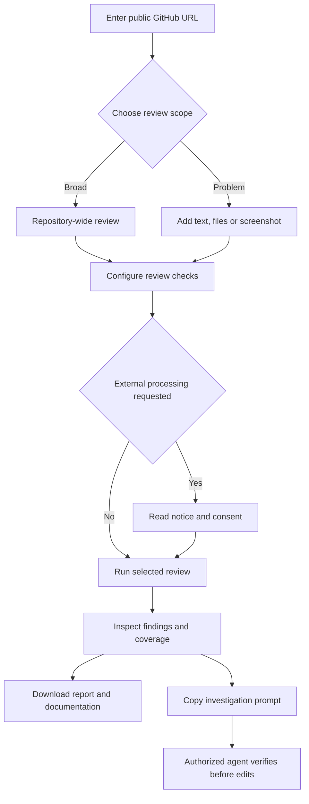
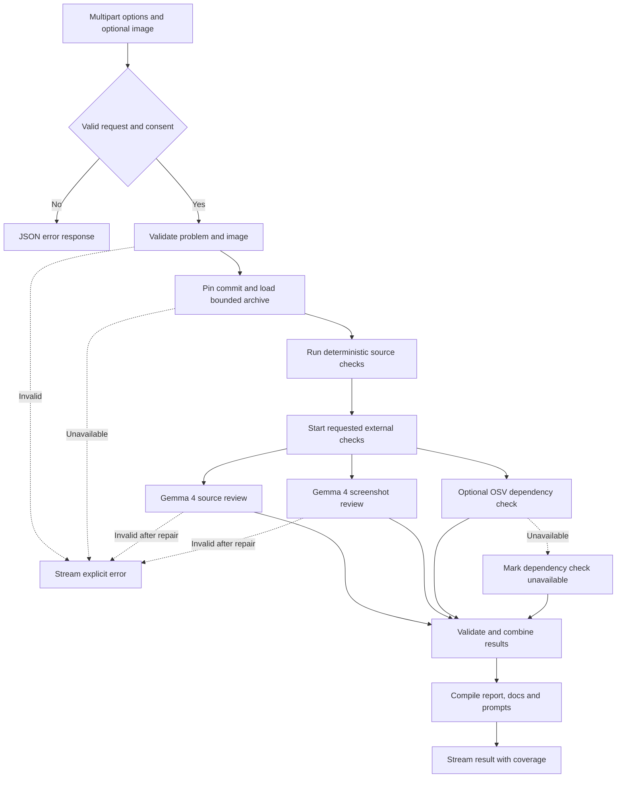

# Workflow and processing flowcharts

These diagrams describe the implemented repository-review workflow. They are Mermaid source embedded for GitHub and exported as SVG for offline viewing. Diagrams follow the actual [pipeline](../src/lib/review/run.ts), [API](../src/app/api/review-repository/route.ts) and [workspace](../src/components/RepositoryWorkspace.tsx), not a proposed service architecture.

## User journey

[Open standalone workflow SVG](assets/diagrams/workflow.svg).

Broad review can also include optional text/files. Problem mode requires text, an attachment or a screenshot. A screenshot requires expected/actual behavior and invokes live visual analysis, even when source AI is off. External processing means source AI, dependency checks or a screenshot.

## Server processing

[Open standalone processing SVG](assets/diagrams/processing.svg).

Input validation and GitHub fetch errors can occur after streaming begins and therefore appear as NDJSON errors inside an HTTP 200 response. The client must read the entire stream; 200 alone is not a successful review.

Static checks precede the parallel requested checks. The three branches do not represent microservices: they are functions within the same review runtime. A requested AI failure aborts the final report. OSV failure can yield partial coverage only if the other requested checks succeed. Each AI path permits one bounded repair for specific validation failures, not unlimited retries.

## Failure and recovery

| Condition | Implemented behavior | User action |
| --- | --- | --- |
| Empty/malformed input | Browser validation or server error | Correct the fields |
| Missing consent for external checks | Request rejected | Read the notice; consent or disable those checks |
| GitHub unavailable/private/limited | Explicit error; no substitute repository | Use an accessible public repo or retry later |
| AI response invalid | One validation repair where supported, then explicit failure | Retry later or choose static-only without screenshot |
| OSV unavailable | Dependency coverage says unavailable | Treat it as incomplete, not clean |
| Inspection limits reached | Truncated coverage warning | Review a smaller scope or use approved local tooling |
| Refresh after result | Memory-only result disappears | Download before refreshing |

No automatic code modification, GitHub issue creation or deployment follows the prompt.

Mermaid rendering convention: [GitHub documentation](https://docs.github.com/en/get-started/writing-on-github/working-with-advanced-formatting/creating-diagrams). Text descriptions above remain usable without diagram rendering.
