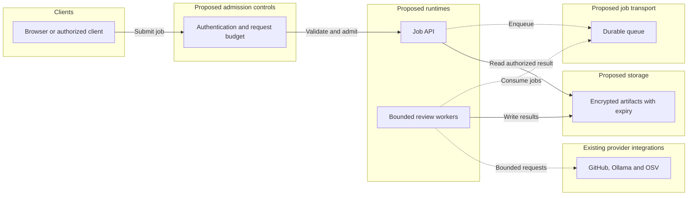

# Scalability and performance readiness

## Verdict and evidence level

**Current status: bounded hackathon implementation; production capacity is not established.** No load, soak, throughput, percentile-latency or production cost benchmark has been run. The unit tests and responsive browser tests in [TEST_REPORT.md](TEST_REPORT.md) validate different properties and do not establish scalability.

This is a code-based assessment of the implementation at base `7d1847f` (unchanged backend in the later UI/documentation work), reviewed 26 October 2026. Recommendations below are proposed work, not deployed capabilities. No specific concurrent-user or requests-per-second capacity is claimed.

## Current resource envelope

| Dimension | Implemented bound / behavior | Source |
| --- | --- | --- |
| Compressed archive | 20 MiB maximum | [github.ts](../src/lib/review/github.ts) |
| Expanded archive | 64 MiB maximum; synchronous gzip expansion | [github.ts](../src/lib/review/github.ts) |
| Included source | 1,000 files; 8 MiB total; ordinary file 256,000 bytes; package-lock 2,000,000 bytes | [github.ts](../src/lib/review/github.ts) |
| Problem evidence | Text and each file up to 20,000 characters; three files; combined 60,000 UTF-8 bytes | [inputs.ts](../src/lib/review/inputs.ts) |
| Screenshot | At most 4 MiB when VERCEL=1; at most 8 MiB locally; decoded input capped at 16 million pixels; normalized output rechecked | [image.ts](../src/lib/image.ts), [limit](../src/lib/upload-limit.ts) |
| Source AI | At most 16 excerpts, 5,000 characters each, 45,000 total; schema allows eight findings | [model.ts](../src/lib/review/model.ts) |
| Advisory lookup | At most 200 distinct exact npm versions in one OSV batch; at most 20 dependency findings | [checks.ts](../src/lib/review/checks.ts) |
| Static findings | Up to 70 leads; most rules limited to two matches per file | [checks.ts](../src/lib/review/checks.ts) |
| Combined output | Up to 100 findings; final schema validation | [run.ts](../src/lib/review/run.ts) |
| Timeouts | GitHub JSON requests 15s each; archive 25s; OSV 15s; model call 45s | Importer, checks and [model adapter](../src/model/gemma-client.ts) |
| Route duration | Source exports maxDuration=180; effective hosting limits depend on the actual account/configuration | [route](../src/app/api/review-repository/route.ts) |

These are input/code limits, not a measured RAM ceiling, request latency guarantee or hosting entitlement.

## Bottlenecks and failure pressure

1. **Memory amplification.** Requests are buffered; compressed and expanded archives, source strings, normalized image buffers and generated artifacts can coexist. Peak RAM can exceed the input caps. There is no measured per-review peak and no global in-process concurrency semaphore.
2. **CPU/event-loop blocking.** `gunzipSync`, string scans, sorting, hashing and report compilation execute in the review runtime. More concurrent requests may increase tail latency before provider limits are reached.
3. **External latency and quotas.** Each review performs two GitHub JSON lookups and an archive download. Source AI and screenshot AI are separate calls, each permitting one repair for selected invalid outputs. OSV, source AI and screenshot AI are requested concurrently after static checks; parallelism does not increase provider quota.
4. **No shared caching or deduplication.** Provider requests use no-store and each user can request the same commit again. Bounded excerpts reduce work per call, but repeated analysis still costs time and provider usage.
5. **No admission control.** Application authentication, tenant quotas, paid-request budgets and distributed throttling are absent. The Origin check is not authentication or abuse prevention.
6. **Cancellation gap.** Browser cleanup can abort the fetch; the route's stream cancel handler only stops enqueueing. It does not pass a shared cancellation signal into the ongoing review/provider work. A rejected parallel branch also does not cancel sibling work.
7. **No durable jobs or recovery.** Work belongs to a request, results are memory-only, and there is no persisted job status, checkpoint, queue or durable retry workflow.

No database avoids a current database bottleneck but is not evidence of unlimited scale or durable delivery.

## Measurement model, not a benchmark

A useful starting decomposition is:

`review time ≈ input validation + GitHub fetch/parse + static checks + max(requested external paths) + compilation`

Retries add time within a path. Event-loop contention, network variability and hosting cold starts can invalidate a simple estimate. Measure each stage rather than adding timeout values and calling the sum a benchmark.

For a stable admitted workload, average in-flight work is approximately arrival rate multiplied by average completion time. Both inputs are unknown here. Peak-memory and quota budgets must determine admission limits before capacity is advertised.

Track stage duration, total p50/p95/p99, peak RSS, event-loop delay, provider status/repair count, completed/partial/failed outcomes and estimated provider usage. Use request IDs and bounded metrics; never log source text, images, prompts or credentials by default.

## Proposed evolution, not implemented

[Standalone proposed architecture SVG](assets/diagrams/future.svg).

| Phase | Proposed work | Verification gate |
| --- | --- | --- |
| 1: Protect the demo | Authentication/admission budget, global concurrency cap, cancellation propagation, stage metrics | Saturation returns bounded errors; abandoned work terminates; no sensitive logs |
| 2: Reduce repeated work | Commit-and-check-version cache, deduplication, expiration/invalidation policy | Same approved input reuses safe results; different evidence or rules cannot collide |
| 3: Decouple long work | Job API, durable queue, bounded workers, idempotent attempts | Restart and duplicate-delivery tests pass; permissions apply to status and artifacts |
| 4: Scale with evidence | Horizontal workers behind measured quotas, load/soak/failure tests | Published SLOs reflect measured results and an approved budget |

Caching user text/images or results introduces privacy, authorization and retention obligations; do not globally cache private context. A queue would require new persisted state and operations, not just a diagram change.

## Proposed load-test protocol

**Not executed.** Run only on an owner-approved isolated deployment and synthetic repositories. Do not load-test the public production URL, GitHub, Ollama or OSV without authorization and suitable quotas.

- Separate deterministic tests with controlled providers from a small, capped real-provider smoke test.
- Test small/medium/near-limit archives; many tiny files; high-compression input rejected at the expanded cap; screenshot normalization; long evidence; empty results.
- Increase approved concurrency in stages, with hard abort thresholds for memory, failure rate, latency and provider budget. Do not equate a chosen test level with supported capacity.
- Inject slow/failed providers, invalid AI output, client disconnects and runtime restarts. Verify partial/error labels, bounded repairs and no hidden fallback.
- Record code SHA, runtime/memory setting, test source, payload sizes, concurrency schedule, provider mode and sample count with every result.
- Publish metrics and raw redacted results only after measurement. Throughput, SLOs and cost per review remain **Not measured** today.

[Operating checklist](OPERATIONS_RUNBOOK.md) · [Security and privacy](SECURITY_AND_PRIVACY.md)
