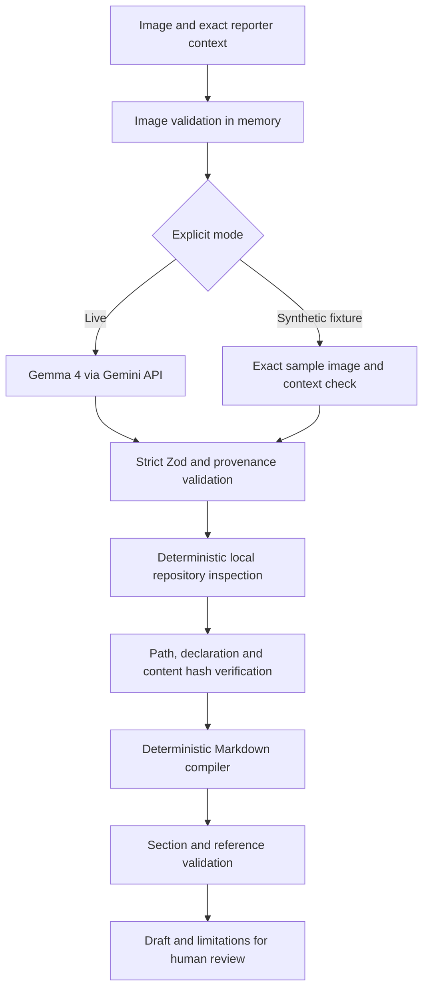

# Architecture and trust boundaries

Only the image and reporter context cross the model boundary. Repository contents are read locally, never sent to Gemma. The web route chooses a fixed fixture root; clients cannot specify a filesystem path. The CLI accepts an explicit authorized local root. Both entry points call the same `runBugLens` implementation.

The browser receives typed NDJSON stage events, a validated result, or a typed error. Results and preview URLs stay in React memory. No database, local storage, session storage, model fallback or background job is used.

Repository files are bounded, sorted, read, ranked and hashed. Compilation rechecks the selected snapshots. This reduces stale references but is not a filesystem sandbox against a malicious process concurrently replacing directories. Only inspect trusted local checkouts. Browser source inspection is limited to the bundled immutable fixture.

The semantic guard is intentionally conservative and inspectable. It blocks common CSS, DOM, environment and causal language in visual facts. It cannot prove arbitrary natural-language truth. Classification, structure, exact reporter quotes and path identity are deterministic; visual correctness remains model-assisted and requires human review.
