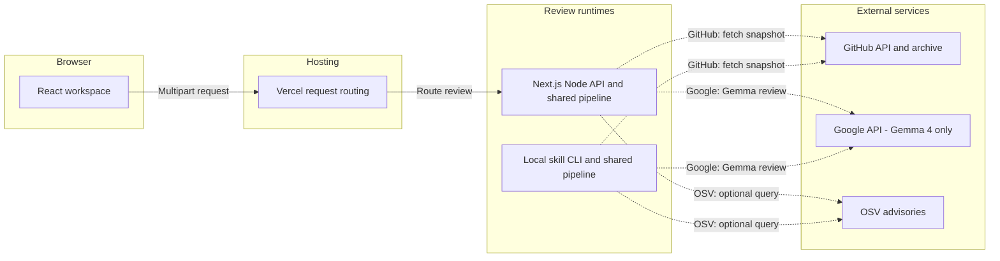

# Architecture and trust boundaries

The repository-first UI and refreshed branding were published in release `a6605e5`. No database, authentication service or automatic repair executor exists.

## Component boundaries

### Implemented deployment view



[Standalone architecture SVG](assets/diagrams/architecture.svg).

The Node API and local skill are alternative runtimes for the same library, not separate network microservices calling each other. API responses travel back through the hosting route as NDJSON; local CLI artifacts go to the local caller. Browser state, archives and intermediate results are memory-only, so there is no datastore node. External calls occur only when selected and authorized. The diagram omits the legacy screenshot-only path for clarity.

[Processing flowcharts](FLOWCHARTS.md) · [API reference](API_REFERENCE.md) · [Scalability assessment](SCALABILITY_REPORT.md) · [Security boundaries](SECURITY_AND_PRIVACY.md)

| Layer | Responsibility | Source |
| --- | --- | --- |
| React containers | State, callbacks, fetch, stream parsing and navigation | [RepositoryWorkspace](../src/components/RepositoryWorkspace.tsx), [DemoWorkspace](../src/components/DemoWorkspace.tsx) |
| Presentation views | Layout, labels, status and controls; no service requests | `src/components/RepositoryWorkspaceView.tsx`, `src/components/DemoWorkspaceView.tsx` |
| Node API | Limits, multipart validation, consent and NDJSON | [Review route](../src/app/api/review-repository/route.ts) |
| Shared pipeline | Import, checks, evidence validation and compilation | [run.ts](../src/lib/review/run.ts) |
| Browser session | Memory-only result and preview | [ReportSession](../src/components/ReportSession.tsx) |
| Skill CLI | Same review implementation without a browser | [Review script](../skills/buglens/scripts/review-repository.ts) |

Input repository/symptoms become a commit-pinned snapshot, then evidence-linked leads, then findings, documentation and fix prompts. The browser never executes those prompts.

## HTTP interface

`POST /api/review-repository` accepts multipart data with exactly one `options` JSON field and at most one `image`. Static-only example (replace the example URL):

```json
{"repositoryUrl":"https://github.com/owner/repo","mode":"repository","includeAI":false,"checkDependencies":false,"consent":false,"problem":{"text":"","attachments":[]}}
```

`mode` also accepts `problem`. Attachments contain `name` and `text`. With an image, `context` includes `expectedBehavior`, `actualBehavior` and optional `environment`. AI, OSV or image processing requires `consent:true`. A differing Origin/Host is rejected when Origin is present; this is not authentication.

The response uses `application/x-ndjson`: `{type:"stage",message}`, followed by `{type:"result",result}` or `{type:"error",error:{code,message}}`. HTTP 200 can contain an application error; parse the stream. Pre-stream errors use JSON (normally 400, 413 for size, 403 for origin). The exact [result schema](../src/lib/review/schema.ts) is authoritative.

The separate `POST /api/analyze-visual` serves the original screenshot workflow. `GET /api/sample-image?id=clipping` serves a bundled sample; neither replaces repository review.

## Repository review
The browser sends a public GitHub URL, review options, optional problem text/files and an optional screenshot to the Node-only `/api/review-repository` route. The standalone skill calls the same `runRepositoryReview` pipeline.

1. Validate the URL and input limits. Only fixed HTTPS GitHub API and codeload hosts are requested; redirects are disabled.
2. Resolve the default branch to a commit SHA. Download a bounded archive and parse it in memory. No Git hooks, dependencies, repository code or tests run.
3. Skip unsafe paths, symlinks, sensitive-looking files and dependency/build folders. Apply size/file limits and record coverage.
4. Run deterministic source-pattern checks over included supported files. Run the selected external checks in parallel: Gemma 4 code review, OSV npm advisory matches and Gemma 4 screenshot analysis. Source review is enabled by default in the web app; screenshot analysis runs when an image is supplied. External processing requires consent.
5. Require exact supplied path, line and quote for every model source finding. Label all findings as needing verification. Keep screenshots, reporter statements and source hypotheses distinct.
6. Compile report, remediation documentation and coding-agent prompts. Include evidence, coverage and explicit runtime gaps.

The problem investigation mode uses the supplied text and screenshot context to rank source excerpts and focus AI review. Broad static findings stay labeled as general repository findings. The combined prompt prioritizes the supplied problem and related source leads.

## Data boundaries
Google receives selected partially redacted source excerpts and problem inputs when code review is enabled, and screenshot/context when visual analysis is enabled. OSV receives exact package names and versions, not repository source. GitHub requests are anonymous; shared API limits can stop a review.

Archives, source snapshots, prompts and images are processed in memory. React holds the output without local/session storage. Refreshing clears it. No server history is intentionally saved. Provider and hosting data practices remain separate. Credential-pattern redaction is not a guarantee; do not submit secrets.

Source is untrusted data. It is never executed. Reports and prompts are also untrusted review leads, not authorization to execute commands or publish changes. Fix prompts require checking repository instructions, preserving unrelated changes, verifying issues and inspecting scripts before safe testing in an approved isolated environment.

## Limits and failure behavior
Archive limits: 20 MB compressed / 64 MB expanded. Source limits: 1,000 files / 8 MB total / 256 KB each, except 2 MB package-lock.json. AI: up to 16 excerpts / 45,000 source characters. OSV: up to 200 distinct exact npm versions from package-lock v2/v3. Other ecosystems and runtime behavior are not checked.

Requested AI failure returns an explicit error, not static-only or fixture output disguised as AI. OSV failure yields a partial report marked unavailable. Semantic validity is not proven by JSON and reference validation: model conclusions can be wrong and static rules have false positives/negatives.

## Original screenshot workflow
The explicit synthetic sample page and authorized local screenshot CLI retain the original `runBugLens` pipeline: image/context validation, provenance-separated visual analysis, deterministic local repository matching and canonical issue compilation. In this separate legacy mode, source remains local and only the image/context is sent to Google. Sample mode validates the exact fixture input and is visibly labeled.
